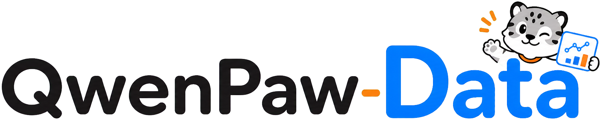
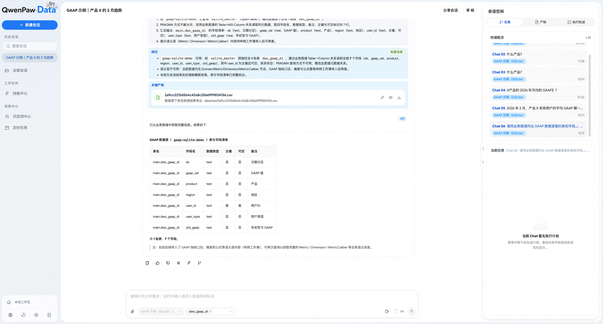
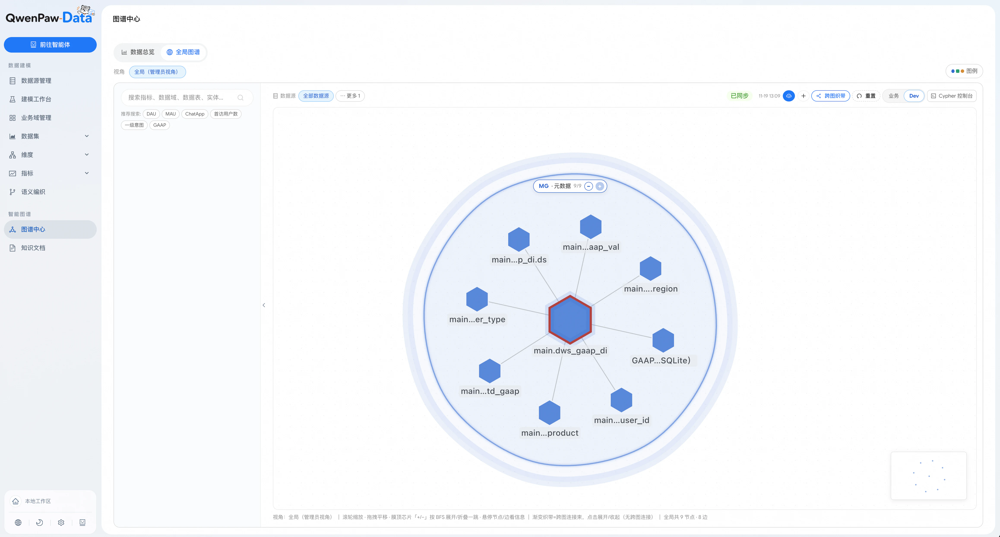
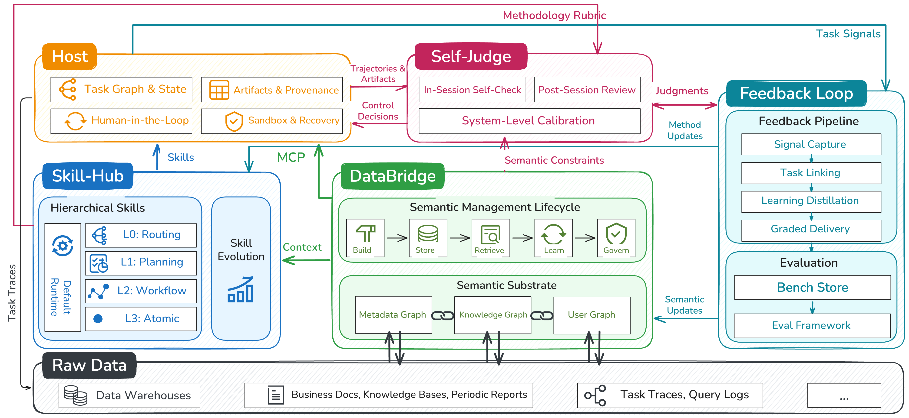
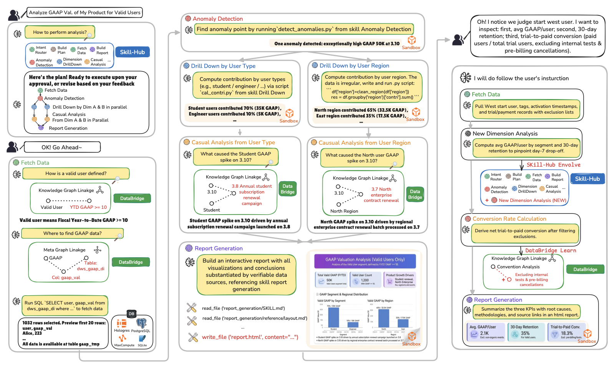

# QwenPaw-Data: Bridging Facts, Methodology, and Execution for Autonomous Enterprise Data Analytics

[中文 README](./README_ZH.md)

[](./LICENSE)
[](https://pypi.org/project/qwenpaw-data-cli/)
[](https://github.com/agentscope-ai/QwenPaw-Data/actions/workflows/ci.yml)

<p align="center">
  
</p>

**QwenPaw-Data is an agentic data system built for enterprise data analysis.**

Use the [standalone browser Console](#browser-console) to ask questions about your data, follow the analysis, and open the resulting reports. No QwenPaw App installation or user account is required.

Enterprise data analysis is becoming a distinct frontier for autonomous agents. It operates in an open, ambiguous, and continuously evolving environment: business concepts must be grounded to the right entities, analytical procedures must be reproducible despite fuzzy feedback, and long-horizon workflows must execute over real enterprise data while preserving artifacts, provenance, and opportunities for human intervention.

QwenPaw-Data organizes its system design around three core dimensions: **facts**, **methodology**, and **execution**. It consolidates heterogeneous enterprise assets from warehouses, dashboards, business documents, interaction logs, and historical tasks into governed and evolvable analytical context, then turns natural-language requests into end-to-end workflows spanning data understanding, retrieval, analysis, report generation, and decision support.

For a complete system-level overview, see the [Technical Report](https://arxiv.org/pdf/2607.11019).

## News

- **[2026-11]** 🎉 QwenPaw-Data ranks first in the general-purpose track of [DataAgentBench](https://ucbepic.github.io/DataAgentBench/), scoring 90.30% with Claude Opus 5.5 (top among closed-source models), 85.62% with Qwen4-Max, and 82.01% with Qwen3.8-Max (top among open-source models).
- **[2026-11]** 🎉 Through automatic skill evolution, QwenPaw-Data reaches 76.82% on [KramaBench](https://arxiv.org/abs/2506.06541), surpassing human experts (76.75%).
- **[2026-07]** 🎉 QwenPaw-Data ranks first on [KramaBench](https://arxiv.org/abs/2506.06541) (68.32%) and [DAComp-DA](https://arxiv.org/abs/2512.04324) (62.38%). See the [Technical Report](https://arxiv.org/pdf/2607.11019).

## QwenPaw-Data 0.4.0

**0.4.0 is available on PyPI.** This release adds DataBridge CM 1.0, reviewed updates to custom skills, and multi-agent collaboration. Read the release notes in [English](./CHANGELOG.md#040-release-highlights) or [中文](./CHANGELOG.md#040-版本亮点). The [GitHub release](https://github.com/agentscope-ai/QwenPaw-Data/releases/tag/v0.4.0) includes all seven packages and their checksums.

The OSS local installation runs without a login or user accounts. Sessions,
settlement items and scheduled jobs belong to the local identity. Use the
initialization/start commands below; for shared-stack development, see
[scripts/README.md](scripts/README.md).

To use the Console inside QwenPaw's workspace or channels, see the [optional App integration](docs/QWENPAW_APP.md).

**Standalone Console.** In this GAAP SQLite session, the agent lists the seven columns of `main.dws_gaap_di`. The same conversation shows the CSV artifact and earlier turns.

[](assets/standalone/gaap-session.webp)

<details>
<summary>View the same sample in the DataBridge Graph Center</summary>

The metadata graph connects the SQLite data source to its table and the table to its seven columns: nine nodes and eight relationships.

[](assets/standalone/gaap-metadata-graph.webp)

</details>

## Core Idea

The design principle of QwenPaw-Data is to decompose enterprise data analysis according to the core questions an AI-native data agent must answer:

- **What facts to use**: the agent needs governed evidence for business concepts, metrics, dimensions, tables, lineage, and historical context.
- **How to analyze**: the agent needs reusable analytical methodology instead of ad-hoc reasoning for every request.
- **How to run**: the agent needs a controllable runtime for long-horizon, artifact-centric workflows.
- **How to improve**: the agent needs to judge its own results and turn user feedback into lasting improvements.

QwenPaw-Data implements this decomposition through four collaborative subsystems:

| Subsystem | Role | What it manages |
| --- | --- | --- |
| **DataBridge** | Evidence grounding | Metadata, business knowledge, user context, metric definitions, data lineage, and task-specific evidence. |
| **Skill-Hub** | Method orchestration | Routing, planning, workflow, and atomic analytical skills, together with references, scripts, and quality expectations. |
| **Host** | Execution control | Task planning and state, agent orchestration, tool invocation, human-in-the-loop control, configurable workspace execution, artifact registry, and recovery. |
| **User Attention Loop** | Quality judgment and feedback | Self-Judge for in-session and post-session result review; Feedback Loop for capturing user and task signals, distilling them, and delivering graded updates to DataBridge and Skill-Hub. |

Together, the four subsystems provide four data-centric capabilities: trustworthy fact grounding, codified analytical methodology, controllable long-horizon execution, and self-evolving data assets.

## Architecture Overview

<p align="center">
  
</p>

DataBridge turns scattered enterprise sources into a governed semantic substrate. Its metadata graph describes databases, tables, columns, metrics, dimensions, and lineage; its knowledge graph captures business entities, definitions, rules, and organizational context; and its user graph captures user roles, preferences, frequently used metrics, and confirmed interpretations.

Skill-Hub sits above this substrate as the method subsystem. It organizes reusable skills from coarse-grained task routing and planning down to workflow-level procedures and atomic analytical operations such as anomaly detection, dimensional drill-down, attribution, visualization, and evidence summarization.

Host makes the facts and methods executable. It reads skill specifications, references, and scripts, materializes them into a DAG execution graph, schedules independent branches in parallel, exposes tools for SQL, Python, file operations, and report construction, and records intermediate and final artifacts.

User Attention Loop closes the loop. Self-Judge reviews the trajectories and artifacts produced by Host, both within the session and independently afterwards, against methodology rubrics from Skill-Hub and semantic constraints from DataBridge. Feedback Loop turns user confirmations, corrections, and task signals into graded updates: semantic updates flow back to DataBridge, method updates flow back to Skill-Hub, and a benchmark store with an evaluation suite measures each change.

## End-to-End Walkthrough

The following walkthrough introduces the system through a typical example: **"analyze the average GAAP value of valid users for product X"**.

<p align="center">
  
</p>

**Plan.** Host consults Skill-Hub to select the relevant routing and planning skills, then decomposes the request into a DAG-shaped workflow: fetch data, detect anomalies, drill down by user type and region in parallel, conduct causal analysis, and generate the final report. DataBridge can already provide high-level hints that constrain which metrics, entities, and dimensions the plan should consider.

**Data retrieval.** DataBridge resolves business terms such as "valid users" through the Knowledge Graph and locates the GAAP metric through the Metadata Graph, linking the logical definition to physical tables and columns. Host invokes the corresponding data-access tools and registers the resulting dataset as an artifact.

**Analysis.** Host follows reusable Skill-Hub assets for anomaly detection, dimensional drill-down, contribution calculation, and causal analysis. During attribution, DataBridge supplies grounded evidence from knowledge and trace history so observed metric changes can be linked to business events, historical traces, or known rules.

**Report generation.** Host uses report-generation skills to organize findings, charts, methods, and source links into a decision-ready report. DataBridge supplies provenance and references so each headline conclusion remains connected to the metric definition, retrieved data, and analysis path that produced it.

**Self-evolution.** The task does not end when the report is delivered. User Attention Loop takes over: Self-Judge reviews the result, and Feedback Loop turns execution traces, user feedback, new analysis demands, and confirmed metric definitions into update signals for DataBridge and Skill-Hub, turning a completed task into reusable experience for the next similar analysis.

## What QwenPaw-Data Can Support

QwenPaw-Data is designed for serious analytical work that data teams handle day to day, including:

- **Business monitoring and anomaly diagnosis**: track core metrics such as DAU, revenue, or conversion, and locate which region, channel, or segment drives an unexpected change.
- **Trend and growth analysis**: analyze access, retention, or conversion trends, identify turning points, and attribute the changes behind them.
- **User and interaction insight**: mine dialogue and behavior logs to understand user intent, user needs, and how they evolve.
- **Periodic business reporting**: produce monthly or quarterly reports from data retrieval to a decision-ready document.
- **Ad-hoc deep-dive analysis**: answer open business questions with multi-dimensional decomposition and contribution attribution.

## Access Modes

For interactive analysis, start with the standalone Console. For automation or integration, use the CLI or the Host API.

| Mode | Purpose | Typical Users | Runtime Form |
| --- | --- | --- | --- |
| **[Standalone Console](#browser-console)** | Ask questions, inspect the steps, and open session reports and files | Analysts | Local browser UI backed by Host; can also serve the DataBridge management UI. |
| **DataBridge UI** | Manage graph memory, semantic config, and related DataBridge assets | Analysts and platform operators | Local management UI backed by the DataBridge API. |
| **CLI** | Platform integration and local administration | Developers and platform teams | Install `qwenpaw-data-cli`; run `qwenpaw-data` to manage data sources, configure semantics, run diagnostics, or start a session on Host. |
| **Headless Engine** | Integrate analysis into a host or frontend | Application developers | [HTTP + replayable SSE service](packages/qwenpaw-data-host-core/README.md#headless-service-optional-service-extra). |
| **QwenPaw App — QPD 0.3 preview** | Analyze data from the QwenPaw workspace and channels | QwenPaw users | Embedded Data Console and channel bridge; see [integration status and setup](docs/QWENPAW_APP.md). |

## Repository Structure

QwenPaw-Data uses a Python + uv workspace monorepo.

The repository currently includes:

- **DataBridge**: manages metadata, business knowledge, trace history, graph memory, and its management interface.
- **Host Core / CLI**: Host orchestration and CLI administration/diagnostics.
- **Data Analysis Skills**: reusable analytical skills and supporting assets.

```text
packages/                  # Python packages
docs/                      # architecture, release, and graph memory docs
scripts/                   # environment setup, startup, and end-to-end scripts
examples/                  # executable local demo data and deterministic smoke test
assets/                    # branding and documentation assets
```

## Quick Start: Clone to the First Data Task

### Browser Console

With [Host](packages/qwenpaw-data-host-core/README.md#headless-service-optional-service-extra) running at `127.0.0.1:8766` and DataBridge at `127.0.0.1:8765`, set `QWENPAW_DATA_API_TOKEN` in the Console terminal to the Host's service token, then run:

```sh
pip install qwenpaw-data-console
qwenpaw-data-console --host-url http://127.0.0.1:8766 --bridge-url http://127.0.0.1:8765
```

Open [the Console](http://127.0.0.1:8767/console) for analysis or [DataBridge](http://127.0.0.1:8767/databridge/) to manage datasources and semantic configuration. The wheel includes both UIs; it does not require Node.js or start the backend services. Omit `--bridge-url` for the Host-only portal. For a source checkout, build the UIs once with `python scripts/build_console.py`. See [Console setup](packages/qwenpaw-data-console/README.md) for separate DataBridge credentials and branding.

### Installing from PyPI

The Python packages are published on PyPI:

```bash
pip install qwenpaw-data-cli        # `qwenpaw-data` command + host runtime
pip install qwenpaw-data-context    # DataBridge backend as a library
```

`pip install qwenpaw-data-cli` suits platform integrations that already run a
DataBridge service. The full local experience — DataBridge UI, demo data,
and managed services — uses the source checkout below.

### 0. Install local prerequisites

Windows 11, macOS, and Linux are supported. Install the following before continuing:

- Git
- [uv](https://docs.astral.sh/uv/getting-started/installation/)
- Node.js 22.22 or newer on the Node 22 LTS line, and npm
- Docker Desktop or Docker Engine with Docker Compose

DataBridge uses Python 3.12 by default. If it is not installed, `uv` can provision the interpreter during initialization. Start Docker Desktop/Engine before starting local services.
Windows users need PowerShell 7 and Docker Desktop configured for Linux
containers. Native Windows is covered by CI; WSL2 remains the recommended
fallback when a local Docker or networking setup is incompatible. See
[`docs/WINDOWS.md`](docs/WINDOWS.md).

### 1. Clone the repository and create local configuration

```bash
git clone https://github.com/agentscope-ai/QwenPaw-Data.git
cd QwenPaw-Data
cp .env.example .env
```

```powershell
git clone https://github.com/agentscope-ai/QwenPaw-Data.git
Set-Location QwenPaw-Data
Copy-Item .env.example .env
```

Keep all local settings in the root `.env`. Do not commit an `.env` that contains credentials.
Replace `NEO4J_PASSWORD=YOUR_PASSWORD` with a password for the local Neo4j instance.

### 2. Configure the package mirror and models

For faster downloads in mainland China, add a mirror to `.env`, for example:

```bash
UV_DEFAULT_INDEX=https://mirrors.aliyun.com/pypi/simple/
```

The Tsinghua mirror is also supported:

```bash
UV_DEFAULT_INDEX=https://pypi.tuna.tsinghua.edu.cn/simple
```

Then configure the shared DataBridge and QwenPaw Data CLI model. The CLI uses these
OpenAI-compatible settings by default; the `QWENPAW_DATA_MODEL_*` variables are only
needed when the CLI should use a different model:

```bash
OPENAI_API_KEY=replace-with-your-api-key
OPENAI_BASE_URL=https://dashscope.aliyuncs.com/compatible-mode/v1
LLM_MODEL=qwen3.7-max
EMBED_MODEL=text-embedding-v3
EMBED_DIM=1024

# Optional CLI-specific overrides:
# QWENPAW_DATA_MODEL_PROVIDER=openai
# QWENPAW_DATA_MODEL_NAME=qwen3.7-max
# QWENPAW_DATA_MODEL_API_KEY=replace-with-your-api-key
# QWENPAW_DATA_MODEL_BASE_URL=https://dashscope.aliyuncs.com/compatible-mode/v1
```

### 3. Initialize the local environment

```bash
# macOS / Linux
python3 scripts/init_local.py
```

```powershell
.\scripts\init_local.ps1
```

The initializer:

1. Creates `packages/qwenpaw-data-context/.venv`, installs the DataBridge backend, and builds the management UI.
2. Exports pinned versions and hashes from the committed `uv.lock`, installs them into the root `.venv` through the configured `UV_DEFAULT_INDEX`, and installs every workspace package in editable mode.
3. Imports the `databridge` MCP client into `${QWENPAW_DATA_HOME:-~/.qwenpaw-data}/host/workspace/.mcp` using a temporary source file.
4. Publishes the `qwenpaw-data` command without replacing an existing command:
   `${QWENPAW_DATA_CLI_BIN_DIR:-~/.local/bin}` on macOS/Linux, or
   `%LOCALAPPDATA%\QwenPaw Data\bin\qwenpaw_data.cmd` on Windows.

The mirror only controls downloads: initialization neither rewrites nor deletes `uv.lock`, and it does not leave a lockfile diff. Do not pass `--skip-build` on the first run; use `scripts/init_local.py --skip-build` (or the same option with the PowerShell wrapper) only when frontend build artifacts already exist.

If another system manages MCP configuration for the default workspace, pass `--skip-mcp-config` to the initializer.

On Windows, make the generated launcher available in the current PowerShell
terminal:

```powershell
$QwenPawDataBin = Join-Path $env:LOCALAPPDATA "QwenPaw Data\bin"
$env:Path = "$QwenPawDataBin;$env:Path"
Get-Command qwenpaw-data
```

See [the native Windows walkthrough](docs/WINDOWS.md) for the persistent user
`Path` option and a clean-machine checklist.

### 4. Start local services in terminal A

If you plan to use the Console, set the same `QWENPAW_DATA_API_TOKEN` for DataBridge, Host, and the Console **before** starting them. This is a service credential, not a browser login.

```bash
# macOS / Linux
python3 scripts/start_local.py
```

```powershell
.\scripts\start_local.ps1
```

This command starts local Neo4j, the DataBridge API, and the DataBridge management UI, not the chat Host or standalone Console. For chat, activate the repository's Python environment in a separate terminal and start Host:

```sh
python -m uvicorn --factory qwenpaw_data.host.core.api.app:create_app --host 127.0.0.1 --port 8766 --workers 1
```

Leave the backends running and [start the Console](#browser-console) in another terminal with the same token.

Default URLs:

```text
DataBridge UI:   http://localhost:3000
DataBridge API:  http://localhost:8765
DataBridge Docs: http://localhost:8765/docs
```

### 5. Initialize the bundled demo in terminal B

The repository includes a deterministic PostgreSQL dataset, semantic workbook,
and Knowledge Graph document. Seed the data, import the semantic configuration,
and register the demo datasource with:

```bash
# macOS / Linux
examples/init_demo.sh --register
```

```powershell
# Windows PowerShell
.\examples\init_demo.ps1 -Register
```

The command is repeatable and creates or reuses `Demo PG - GAAP use case`,
printing its server-generated datasource ID. The dataset has 475 synthetic rows.
It does not upload the Knowledge Graph document; that step requires a configured
Context model and embedding provider.

### 6. Build the demo graphs

Open `http://localhost:3000`:

1. In **Semantic Weaving**, select `Demo PG - GAAP use case` and submit a
   `FULL` weave.
2. In **KG Docs Management**, upload `examples/demo_kg_doc.docx`.
3. Wait until the document status is `ready`.

For a fast test without a real model API key, skip this graph-building step and
run the deterministic smoke test described below.

### 7. Verify the CLI

```bash
command -v qwenpaw-data
qwenpaw-data datasource list
```

```powershell
Get-Command qwenpaw-data
qwenpaw-data datasource list
```

The command should resolve to the launcher published by the initializer, and
`datasource list` should include `Demo PG - GAAP use case`. The CLI loads the repository root `.env`
automatically; set `QWENPAW_DATA_ENV_FILE` only when a different dotenv file is
required.

### 8. Run a real data task

Start the [browser Console](#browser-console), configure a
model, and select `Demo PG - GAAP use case`. Submit:

> Analyze the average GAAP value of valid users for product X during March 2026;
> show the trend over time and explain any spikes with relevant KG events.

The CLI commands `run`, `chat`, `plan`, and `execute` use the running Host service
via `--host-url` or `QWENPAW_DATA_HOST_URL`. Host owns model preferences, tools,
workspaces and persisted sessions; the old in-process embedding API is retired.

The expected peak is 2026-03-10, with an average GAAP value of approximately
`45.89`. Retrieve generated artifacts through the Console or Host file API;
Host scopes its local paths by tenant, workspace, user and session under
`QWENPAW_DATA_HOME`.

For a deterministic end-to-end test without a model API key:

```bash
# macOS / Linux
examples/init_demo.sh
uv run python examples/smoke_test.py
```

```powershell
# Windows PowerShell
.\examples\init_demo.ps1
uv run python .\examples\smoke_test.py
```

See [the full demo guide](examples/README.md) for direct SQL, reset, and
troubleshooting commands. The smoke starts private Host/Context processes and
temporary SQLite state, calls native MCP `execute_read`, and checks a persisted
SQL chat. A separate `examples/semantic_smoke_test.py` exercises semantic
editing and graph publication using local deterministic embedding responses.
Both use real database services but make no external model calls.

## Common Scripts

```bash
# Reuse existing frontend build artifacts
python3 scripts/init_local.py --skip-build

# Initialize without publishing a qwenpaw-data command link
python3 scripts/init_local.py --skip-cli-link

# Start DataBridge services, including the 3000 UI and 8765 API by default
scripts/init_databridge.sh
scripts/start_databridge.sh

# Start only the DataBridge API
scripts/start_databridge.sh --skip-frontend
```

On Windows, pass the same options to `init_local.ps1` or `start_local.ps1`.
The DataBridge-only `.sh` helpers in this block are macOS/Linux conveniences.

## Workspace Isolation

The Host server selects its workspace backend at startup using
`QWENPAW_DATA_WORKSPACE_BACKEND`. The default is `docker`, which requires a running
Docker daemon. Initialization errors stop startup; there is no fallback to local
execution. The retired CLI `--workspace` flag does not configure
the current server.

| Backend | Isolation | Requirements | When to use |
|---------|-----------|--------------|-------------|
| `docker` (default) | Container-based workspace execution | a running Docker daemon | Tasks requiring separation from the host |
| `local` (explicit opt-in) | Shell commands execute with host-user privileges; not a sandbox | trusted deployment and inputs; `QWENPAW_DATA_WORKSPACE_BACKEND=local` | Trusted development only |

```bash
# Check the environment first (Docker daemon, Neo4j, DataBridge API)
qwenpaw-data doctor

# Set this in the Host process environment before starting the local stack.
export QWENPAW_DATA_WORKSPACE_BACKEND=docker
```

Use Console settings for tool confirmations. A confirmation policy is not an
execution sandbox and does not remove the privileges of local shell commands.

Notes for the `docker` backend:

- The container image is built on first use (`python:3.11-slim` + the
  analysis stack: pandas, numpy, matplotlib, openpyxl). Customize via
  `QWENPAW_DATA_DOCKER_BASE_IMAGE` / `QWENPAW_DATA_DOCKER_EXTRA_PIP`.
- Containers reach host services (DataBridge) through
  `host.docker.internal` (override with `QWENPAW_DATA_DOCKER_HOST_ALIAS`).
  Containers are stopped and removed when the run finishes.
- Docker commands run in dedicated process groups. Timeout and cancellation
  trigger TERM/KILL cleanup; if cleanup itself fails, QwenPaw Data closes the
  workspace container rather than leaving an unknown process running.
- On macOS, [colima](https://github.com/abiosoft/colima) provides an
  unattended, license-free Docker daemon:
  `brew install colima docker && colima start`.
- Current boundary is the container itself: resource limits
  (CPU/memory/pids), egress network policy, and non-root execution are
  not yet applied — they are on the roadmap. Do not treat the `docker`
  backend as a hardened sandbox.

## Security Model and Known Limitations

QwenPaw-Data is designed for **local-first, single-user deployments**. Read this
section before exposing any service beyond `127.0.0.1`.

- **Network**: all services bind to `127.0.0.1` by default. Exposing them
  (`--host 0.0.0.0`, `FRONTEND_HOST`, `QWENPAW_DATA_MCP_HOST`) is an explicit
  opt-in; configure `QWENPAW_DATA_API_TOKEN` or scoped `QWENPAW_DATA_API_KEYS` first so
  the DataBridge REST and HTTP MCP endpoints require a `Bearer` token, and
  restrict `QWENPAW_DATA_CORS_ORIGINS` to trusted origins.
- **Execution**: the Host server defaults to a **Docker** workspace and does not
  fall back to local execution when Docker is unavailable. Explicitly selecting
  `QWENPAW_DATA_WORKSPACE_BACKEND=local` gives shell tools host-user privileges even
  after confirmation. Neither path checks nor confirmation prompts are a
  sandbox. Docker's resource and network limits remain as stated above.
- **Authorization**: scoped API keys separate `query`, `write`, `manage`, and
  `credentials:manage`. `QWENPAW_DATA_API_TOKEN` remains a full-scope compatibility
  key. For scoped clients, set `QWENPAW_DATA_CLIENT_API_TOKEN`; every API route is
  fail-closed until explicitly classified. This is API-key authorization, not
  a multi-user identity/RBAC system.
- **Browser and abuse controls**: unsafe browser requests are checked against
  the exact CORS/Origin allowlist and Fetch Metadata. Authentication failures
  enter a per-client penalty box; authenticated requests use per-principal,
  per-scope token buckets. Privileged operations and Host, authentication,
  authorization, CSRF, and rate-limit denials are written as body-free JSON
  records to `security_audit.jsonl`. Forwarded client IPs are trusted only when
  `QWENPAW_DATA_TRUSTED_PROXIES` is explicitly configured.
  The same edge controls apply to standalone HTTP MCP mode.
  Throttle state is process-local; multi-worker or horizontally scaled
  deployments need a shared limiter at the gateway or application layer.
- **Scope**: import task status and preview/confirm plans use a process-safe
  SQLite job store with TTL, idempotency, leases, retry bounds, and restart
  recovery. Interrupted in-process work is marked failed after restart rather
  than silently disappearing; automatic resumption is only implemented for
  embedding rebuild jobs. Native Windows support and its validation boundary
  are documented in `docs/WINDOWS.md`. See `SECURITY.md` for how to report
  vulnerabilities.

To store only a token digest in `QWENPAW_DATA_API_KEYS`, generate it with:

```bash
printf %s 'your-long-random-token' | shasum -a 256
```

Operational and release references:

- [Resource governance](./docs/RESOURCE_GOVERNANCE.md)
- [Compatibility policy](./docs/COMPATIBILITY.md)
- [Internal baseline and OSS adapter decision](./docs/adr/0001-internal-baseline-and-oss-adapters.md)
- [Release process and public-history boundary](./docs/RELEASING.md)
- [Security policy](./SECURITY.md)
- [Support and version policy](./SUPPORT.md)
- [Changelog](./CHANGELOG.md)

## License

QwenPaw-Data is licensed under the [Apache License 2.0](./LICENSE).
See [NOTICE](./NOTICE) for third-party attributions and
[CONTRIBUTING.md](./CONTRIBUTING.md) for how to contribute.
