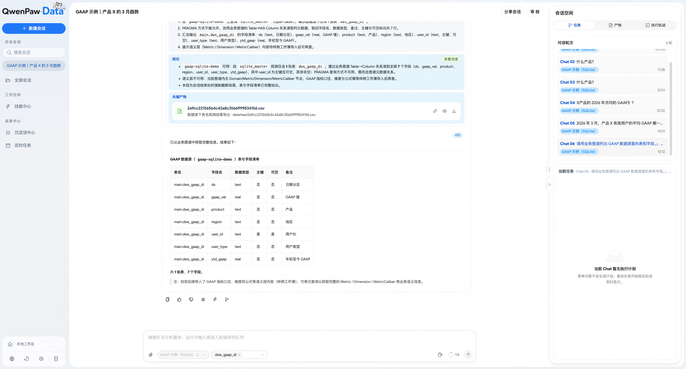
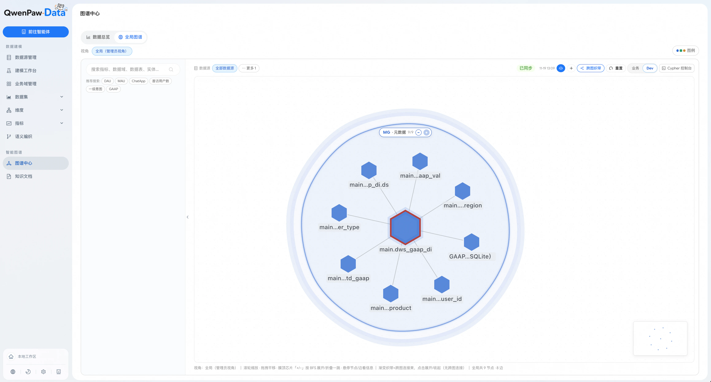
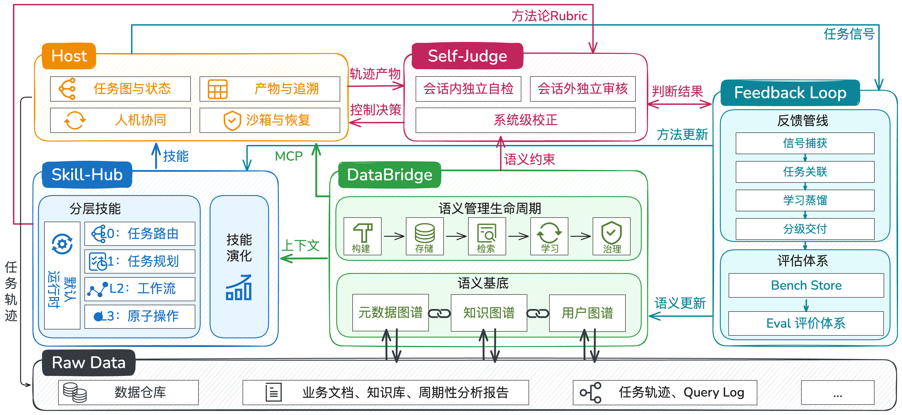
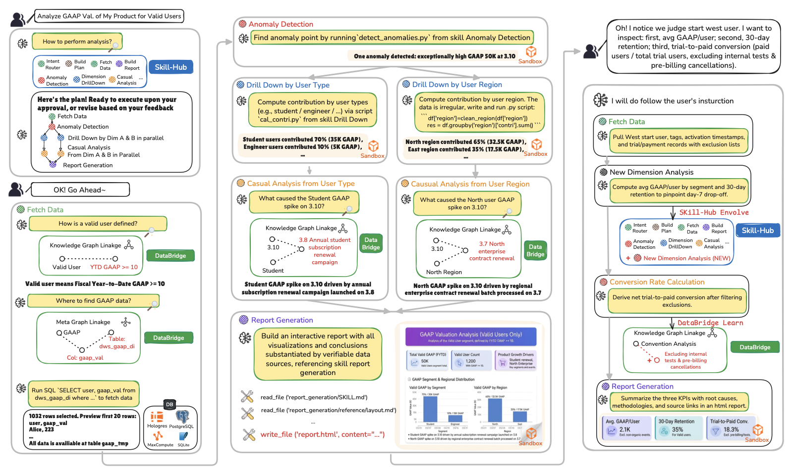

# QwenPaw-Data: Bridging Facts, Methodology, and Execution for Autonomous Enterprise Data Analytics

[英文 README](./README.md)

[](./LICENSE)
[](https://pypi.org/project/qwenpaw-data-cli/)
[](https://github.com/agentscope-ai/QwenPaw-Data/actions/workflows/ci.yml)

<p align="center">
  
</p>

**QwenPaw-Data 是一个面向企业数据分析的智能体数据系统。**

用[独立浏览器控制台](#独立浏览器控制台)就能提问、查看分析步骤、打开生成的报告。不需要安装 QwenPaw App，也不需要注册账号。

企业数据分析正在成为自主智能体的重要方向。它运行在开放、模糊且持续变化的环境中：业务概念需要锚定到正确的数据实体，分析过程需要在模糊反馈下保持可复现，长链路工作流需要在真实企业数据上执行，并保留分析产物、来源记录和人类中途干预的空间。

QwenPaw-Data 围绕**事实**、**方法**与**执行**三个核心维度组织系统能力。它将分散在数仓、看板、业务文档、交互日志和历史任务中的异构企业资产整理为可治理、可演进的分析上下文，并将自然语言请求转化为端到端工作流，覆盖数据理解、数据获取、数据分析、报告生成和辅助决策。

完整的系统级说明可参考 [技术报告](https://arxiv.org/pdf/2607.11019)。

## 新闻

- **[2026-11]** 🎉 QwenPaw-Data 在 [DataAgentBench](https://ucbepic.github.io/DataAgentBench/) 通用赛道位列第一：基于 Claude Opus 5.5 取得 90.30%（闭源模型第一），基于 Qwen4-Max 取得 85.62%，基于 Qwen3.8-Max 取得 82.01%（开源模型第一）。
- **[2026-11]** 🎉 经过 Skill Evolution，QwenPaw-Data 在 [KramaBench](https://arxiv.org/abs/2506.06541) 上的准确率提升至 76.82%，突破人类专家水平（76.75%）。
- **[2026-07]** 🎉 QwenPaw-Data 在 [KramaBench](https://arxiv.org/abs/2506.06541)（68.32%）和 [DAComp-DA](https://arxiv.org/abs/2512.04324)（62.38%）上位列第一，详见[技术报告](https://arxiv.org/pdf/2607.11019)。

## QwenPaw-Data 0.4.0

**0.4.0 已正式发布到 PyPI。** 本版将 DataBridge 升级至 CM 1.0，支持经审核的自定义技能更新和多智能体协作。详见[中文发布说明](./CHANGELOG.md#040-版本亮点)或[英文发布说明](./CHANGELOG.md#040-release-highlights)。[GitHub Release](https://github.com/agentscope-ai/QwenPaw-Data/releases/tag/v0.4.0) 提供全部 7 个包及其校验和。

OSS 本机版不设用户账号，无需登录。会话、沉淀项和定时任务仍归本机身份所有。
本机初始化和启动见下文；共享服务栈的开发流程另见[脚本说明](scripts/README.md)。

如果希望从 QwenPaw 工作区或渠道会话进入控制台，请参阅[可选的 App 集成说明](docs/QWENPAW_APP_ZH.md)。

**独立控制台。** 在这次 GAAP SQLite 示例会话中，智能体列出了 `main.dws_gaap_di` 的 7 个字段。在同一个会话里可以下载 CSV 产物，也可以回看之前的对话轮次。

[](assets/standalone/gaap-session.webp)

<details>
<summary>在 DataBridge 图谱中心查看同一份样例</summary>

元数据图展示了 SQLite 数据源、数据表和 7 个字段之间的关系：从数据源连到表，再从表连到字段，共 9 个节点、8 条边。

[](assets/standalone/gaap-metadata-graph.webp)

</details>

## 核心思路

QwenPaw-Data 的设计原则是按照智能体原生数据分析系统必须回答的核心问题来拆解企业数据分析：

- **应该使用哪些事实**：智能体需要围绕业务概念、指标、维度、表结构、血缘和历史上下文获取可治理证据。
- **应该如何分析**：智能体需要可复用的分析方法，减少每次请求中的临场推理。
- **应该如何执行**：智能体需要一个可控制的运行时来承载长链路、以分析产物为中心的工作流。
- **应该如何改进**：智能体需要判断自身结果的质量，并把用户反馈转化为持续的改进。

QwenPaw-Data 通过四个协同子系统实现这一拆解：

| 子系统 | 角色 | 管理内容 |
| --- | --- | --- |
| **DataBridge** | 事实锚定 | 元数据、业务知识、用户上下文、指标定义、数据血缘和任务相关证据。 |
| **Skill-Hub** | 方法编排 | 路由、规划、流程和原子分析技能，以及相关参考资料、脚本和质量要求。 |
| **Host** | 执行控制 | 任务规划与状态管理、智能体编排、工具调用、人机协同、可配置的工作区执行、产物登记和恢复。 |
| **User Attention Loop** | 质量判断与反馈 | Self-Judge 在会话内和会话后独立审核结果；Feedback Loop 捕获用户与任务信号，提炼后分级交付给 DataBridge 和 Skill-Hub。 |

四个子系统共同提供四类数据分析能力：可信事实锚定、标准化分析方法、可控制的长链路执行，以及可自演进的数据资产。

## 架构概览

<p align="center">
  
</p>

DataBridge 将分散的企业信息源转化为可治理的语义基底。元数据图（Metadata Graph）描述数据库、表、列、指标、维度和血缘；知识图（Knowledge Graph）捕获业务实体、定义、规则和组织上下文；用户图（User Graph）记录用户角色、偏好、常用指标和已确认的口径理解。

Skill-Hub 位于这一语义基底之上，作为方法子系统组织可复用技能。它覆盖从粗粒度任务路由和任务规划，到工作流级完整流程，再到异常检测、维度下钻、归因、可视化和证据总结等原子分析操作，形成可复用的方法资产。

Host 将事实和方法资产转化为可执行过程。它读取技能规范、参考资料和脚本，将它们转化为 DAG 执行图，并行调度独立分支，提供 SQL、Python、文件操作和报告构建工具，并记录中间产物和最终产物。

User Attention Loop 负责闭环。Self-Judge 在会话内以及会话结束后独立审核 Host 产生的轨迹和产物，依据 Skill-Hub 提供的方法论评分标准和 DataBridge 提供的语义约束进行校正。Feedback Loop 将用户的确认、修正和任务信号转化为分级更新：语义更新回流到 DataBridge，方法更新回流到 Skill-Hub，并由评测集与评估体系衡量每一次改动的效果。

## 端到端示例

下面通过一个典型例子介绍系统：**“分析产品 X 的有效用户平均 GAAP 值”**。

<p align="center">
  
</p>

**规划。** Host 查询 Skill-Hub，选择相关路由和规划技能，并将请求拆解为 DAG 形态的工作流：获取数据、检测异常、按用户类型和地区并行下钻、开展原因分析、生成最终报告。DataBridge 可以在这一阶段提供高层语义提示，约束计划中应考虑的指标、实体和维度。

**数据获取。** DataBridge 通过知识图解析“有效用户”等业务术语，并通过元数据图定位 GAAP 指标，将逻辑定义连接到物理表和列。Host 调用相应的数据访问工具，并将结果数据集登记为分析产物。

**分析。** Host 按照 Skill-Hub 中可复用的技能资产执行异常检测、维度下钻、贡献度计算和原因分析。归因过程中，DataBridge 继续从知识和历史轨迹中提供可信证据，使指标变化能够连接到业务事件、历史记录或已知规则。

**报告生成。** Host 使用报告生成技能，将发现、图表、方法和来源链接组织成可用于决策的报告。DataBridge 提供来源和过程记录，使每个核心结论都能连接回指标定义、取回数据和生成该结论的分析路径。

**自我演进。** 任务在报告交付后继续沉淀。User Attention Loop 接手后续工作：Self-Judge 审核结果，Feedback Loop 将执行轨迹、用户反馈、新分析需求和已确认的指标定义转化为 DataBridge 和 Skill-Hub 的更新信号，使一次完成的任务转化为下一次相似分析可复用的经验。

## 支持的分析场景

QwenPaw-Data 面向数据团队日常处理的严肃分析任务，包括：

- **业务监控与异常诊断**：追踪 DAU、收入、转化率等核心指标，在指标异常时定位由哪个区域、渠道或分群驱动。
- **趋势与增长分析**：分析访问、留存或转化趋势，识别转折点，并归因背后的变化。
- **用户与交互洞察**：挖掘对话和行为日志，理解用户意图、用户需求及其变化趋势。
- **周期性业务报告**：从数据获取到成稿，生成产品或业务线的月报、季报等决策报告。
- **临时深度分析**：回答开放业务问题，通过多维拆解和贡献归因支持业务判断。

## 接入方式

交互式分析可直接使用独立控制台；自动化和平台集成可使用 CLI 或 Host API。

| 模式 | 用途 | 典型用户 | 运行形态 |
| --- | --- | --- | --- |
| **[独立控制台](#独立浏览器控制台)** | 提问、查看分析过程、打开会话报告和文件 | 分析师 | 本机浏览器界面，连接 Host，也可在同一地址提供 DataBridge 管理界面。 |
| **DataBridge UI** | 管理图记忆、语义配置及相关 DataBridge 资产 | 分析师、平台运营 | 本地管理界面，后端对接 DataBridge API。 |
| **CLI** | 平台集成与本地管理 | 开发者、平台团队 | 安装 `qwenpaw-data-cli`，运行 `qwenpaw-data` 管理数据源、配置语义、诊断环境，或连接 Host 发起会话。 |
| **Headless Engine** | 将分析能力接入宿主或前端 | 应用开发者 | [HTTP + 可重放 SSE 服务](packages/qwenpaw-data-host-core/README.md#headless-service-optional-service-extra)。 |
| **QwenPaw App — QPD 0.3 预览** | 从 QwenPaw 工作区和渠道发起数据分析 | QwenPaw 用户 | 内嵌 Data Console 与渠道桥接；详见 [发布预告与使用入口](docs/QWENPAW_APP_ZH.md)。 |

## 项目结构

QwenPaw-Data 采用 Python + uv 工作区的单仓库结构。

当前仓库主要包含：

- **DataBridge**：管理元数据、业务知识、历史轨迹、图记忆及其管理界面。
- **Host Core / CLI**：Host 编排能力与 CLI 管理、诊断入口。
- **数据分析技能**：可复用的分析技能及配套资源。

```text
packages/                  # Python 包
docs/                      # 架构、发布与图记忆文档
scripts/                   # 环境配置、启动与端到端脚本
examples/                  # 可执行本地演示数据与确定性冒烟测试
assets/                    # 品牌与文档资源
```

## 快速开始：从 clone 到第一个数据任务

### 独立浏览器控制台

先启动 [Host](packages/qwenpaw-data-host-core/README.md#headless-service-optional-service-extra)（此例为 `127.0.0.1:8766`）和 DataBridge（`127.0.0.1:8765`）。在启动控制台的终端设置 `QWENPAW_DATA_API_TOKEN`，值与 Host 的服务令牌一致，然后运行：

```sh
pip install qwenpaw-data-console
qwenpaw-data-console --host-url http://127.0.0.1:8766 --bridge-url http://127.0.0.1:8765
```

打开[控制台](http://127.0.0.1:8767/console)发起分析，或打开 [DataBridge](http://127.0.0.1:8767/databridge/) 管理数据源和语义配置。安装包自带两个界面，不需要 Node.js，也不会代为启动后端服务。只连接 Host 时可省略 `--bridge-url`。从源码运行则需先执行一次 `python scripts/build_console.py` 构建界面。独立的 DataBridge 令牌和品牌配置见[控制台说明](packages/qwenpaw-data-console/README.md)。

### 通过 PyPI 安装

Python 包已发布到 PyPI：

```bash
pip install qwenpaw-data-cli        # `qwenpaw-data` 命令 + 宿主运行时
pip install qwenpaw-data-context    # 以库形式使用 DataBridge 后端
```

`pip install qwenpaw-data-cli` 适合已运行 DataBridge 服务的平台集成场景。完整的
本地体验（DataBridge UI、演示数据与本地服务）请使用下面的源码方式。

### 0. 准备本地依赖

支持 Windows 11、macOS 和 Linux。开始前请安装：

- Git
- [uv](https://docs.astral.sh/uv/getting-started/installation/)
- Node.js 22.22 或更高版本（Node 22 LTS）与 npm
- Docker Desktop 或包含 Docker Compose 的 Docker Engine

DataBridge 默认使用 Python 3.12；如果本机没有，`uv` 会在初始化时准备对应解释器。启动本地服务前，请先启动 Docker Desktop/Engine。
Windows 用户需要 PowerShell 7，并将 Docker Desktop 配置为 Linux
containers。Native Windows 流程已纳入 CI；如果本机 Docker 或网络环境不兼容，
推荐使用 WSL2。详见 [`docs/WINDOWS.md`](docs/WINDOWS.md)。

### 1. Clone 仓库并创建本地配置

```bash
git clone https://github.com/agentscope-ai/QwenPaw-Data.git
cd QwenPaw-Data
cp .env.example .env
```

```powershell
git clone https://github.com/agentscope-ai/QwenPaw-Data.git
Set-Location QwenPaw-Data
Copy-Item .env.example .env
```

所有本地配置都写入根目录 `.env`。不要提交包含密钥的 `.env`。
请将 `NEO4J_PASSWORD=YOUR_PASSWORD` 替换为本地 Neo4j 实例的密码。

### 2. 配置下载镜像和模型

国内网络建议在 `.env` 中添加一个镜像配置，例如：

```bash
UV_DEFAULT_INDEX=https://mirrors.aliyun.com/pypi/simple/
```

也可以使用清华镜像：

```bash
UV_DEFAULT_INDEX=https://pypi.tuna.tsinghua.edu.cn/simple
```

然后填写 DataBridge 与 QwenPaw Data CLI 共用的模型配置。CLI 默认复用这组
OpenAI-compatible 配置；只有需要为 CLI 指定不同模型时，才配置
`QWENPAW_DATA_MODEL_*`：

```bash
OPENAI_API_KEY=replace-with-your-api-key
OPENAI_BASE_URL=https://dashscope.aliyuncs.com/compatible-mode/v1
LLM_MODEL=qwen3.7-max
EMBED_MODEL=text-embedding-v3
EMBED_DIM=1024

# 可选的 CLI 专用覆盖配置：
# QWENPAW_DATA_MODEL_PROVIDER=openai
# QWENPAW_DATA_MODEL_NAME=qwen3.7-max
# QWENPAW_DATA_MODEL_API_KEY=replace-with-your-api-key
# QWENPAW_DATA_MODEL_BASE_URL=https://dashscope.aliyuncs.com/compatible-mode/v1
```

### 3. 初始化本地环境

```bash
# macOS / Linux
python3 scripts/init_local.py
```

```powershell
.\scripts\init_local.ps1
```

初始化脚本会：

1. 创建 `packages/qwenpaw-data-context/.venv`，安装 DataBridge 后端依赖并构建管理界面。
2. 从仓库提交的 `uv.lock` 导出固定版本及 hash，通过 `UV_DEFAULT_INDEX` 指定的镜像安装到根目录 `.venv`，再以 editable 模式安装所有 workspace 包。
3. 使用临时源文件，将名为 `databridge` 的 MCP 客户端导入 `${QWENPAW_DATA_HOME:-~/.qwenpaw-data}/host/workspace/.mcp`。
4. 在不覆盖已有命令的前提下发布 `qwenpaw-data`：macOS/Linux 默认写入
   `${QWENPAW_DATA_CLI_BIN_DIR:-~/.local/bin}`，Windows 默认生成
   `%LOCALAPPDATA%\QwenPaw Data\bin\qwenpaw_data.cmd`。

镜像只影响下载地址，不会重写或删除 `uv.lock`，初始化后仓库也不会因此产生锁文件变更。首次初始化不要使用 `--skip-build`；只有已经存在前端构建产物时才向初始化命令传入 `--skip-build`。

如果其他系统负责管理默认 workspace 的 MCP 配置，向初始化命令传入 `--skip-mcp-config`。

Windows 用户需要在当前 PowerShell 终端中启用初始化程序生成的命令：

```powershell
$QwenPawDataBin = Join-Path $env:LOCALAPPDATA "QwenPaw Data\bin"
$env:Path = "$QwenPawDataBin;$env:Path"
Get-Command qwenpaw-data
```

如何永久加入用户 `Path` 以及干净机器验收步骤见
[Windows 原生走查文档](docs/WINDOWS.md)。

### 4. 在终端 A 启动本地服务

如需使用控制台，请在启动前为 DataBridge、Host 和控制台设置相同的 `QWENPAW_DATA_API_TOKEN`。这是服务之间的凭据，不是浏览器登录密码。

```bash
# macOS / Linux
python3 scripts/start_local.py
```

```powershell
.\scripts\start_local.ps1
```

该命令启动本地 Neo4j、DataBridge API 和 DataBridge 管理界面，不会启动用于对话的 Host 或独立控制台。如需对话，请在另一终端激活仓库的 Python 环境，启动 Host：

```sh
python -m uvicorn --factory qwenpaw_data.host.core.api.app:create_app --host 127.0.0.1 --port 8766 --workers 1
```

保持后端运行，再开一个终端，用同一个服务令牌[启动控制台](#独立浏览器控制台)。

默认地址：

```text
DataBridge UI:   http://localhost:3000
DataBridge API:  http://localhost:8765
DataBridge 文档: http://localhost:8765/docs
```

### 5. 在终端 B 初始化内置 demo

仓库包含确定性的 PostgreSQL 数据、语义配置工作簿和知识图谱文档。执行：

```bash
# macOS / Linux
examples/init_demo.sh --register
```

```powershell
# Windows PowerShell
.\examples\init_demo.ps1 -Register
```

命令可重复运行，会生成 475 行合成数据，创建或复用名为 `Demo PG - GAAP use case` 的数据源，并打印服务端分配的 ID。它不会自动上传知识图谱文档。

### 6. 构建 demo 图谱

打开 `http://localhost:3000`：

1. 在 **Semantic Weaving** 中选择 `Demo PG - GAAP use case`，提交一次
   `FULL` weave。
2. 在 **KG Docs Management** 中上传 `examples/demo_kg_doc.docx`。
3. 等待文档状态变为 `ready`。

如果只想在没有真实模型 API key 的情况下快速走查，可以跳过图谱构建，使用
下文的确定性 smoke test。

### 7. 验证 CLI

```bash
command -v qwenpaw-data
qwenpaw-data datasource list
```

```powershell
Get-Command qwenpaw-data
qwenpaw-data datasource list
```

命令应解析到初始化程序发布的 launcher，`datasource list` 应包含
`Demo PG - GAAP use case`。CLI
会自动加载仓库根目录 `.env`；只有需要使用其他 dotenv 文件时才设置
`QWENPAW_DATA_ENV_FILE`。

### 8. 执行真实数据任务

启动[独立浏览器控制台](#独立浏览器控制台)，配置模型并选择
`Demo PG - GAAP use case`，提交：

> 分析 2026 年 3 月 product X 有效用户的平均 GAAP 值，展示时间趋势，并结合相关 KG 事件解释异常峰值。

也可通过 CLI 的 `run`、`chat`、`plan`、`execute` 连接同一个 Host（`--host-url` 或 `QWENPAW_DATA_HOST_URL`）。模型、工具和会话由 Host 管理；不再支持的是旧的进程内嵌入入口。

预期峰值出现在 2026-03-10，有效用户平均 GAAP 值约为 `45.89`。默认产物
目录在 macOS/Linux 上是
`${QWENPAW_DATA_HOME:-~/.qwenpaw-data}/host/workspace`，在 Windows 上是
`$HOME\.qwenpaw-data\host\workspace`；`QWENPAW_DATA_HOME` 可覆盖该位置。

如需在不使用真实模型 API key 的情况下做确定性端到端走查：

```bash
# macOS / Linux
examples/init_demo.sh
uv run python examples/smoke_test.py
```

```powershell
# Windows PowerShell
.\examples\init_demo.ps1
uv run python .\examples\smoke_test.py
```

直接 SQL、清理和故障排查命令见 [完整 demo 文档](examples/README.md)。

## 常用脚本

```bash
# 复用已有前端构建产物
python3 scripts/init_local.py --skip-build

# 初始化但不发布 qwenpaw-data 命令软链接
python3 scripts/init_local.py --skip-cli-link

# 启动 DataBridge 服务（默认包含 3000 管理界面和 8765 API）
scripts/init_databridge.sh
scripts/start_databridge.sh

# 只启动 DataBridge API
scripts/start_databridge.sh --skip-frontend
```

Windows 可向 `init_local.ps1` 或 `start_local.ps1` 传入相同参数；本段的
DataBridge-only `.sh` 脚本仅作为 macOS/Linux 便捷入口。

## 工作区隔离

Host 服务在启动时通过 `QWENPAW_DATA_WORKSPACE_BACKEND` 选择工作区后端。
默认值为 `docker`，需要运行中的 Docker daemon；初始化失败会停止启动，不会
自动回退到本地执行。已停用的 CLI `--workspace` 参数不能配置当前服务。

| 后端 | 隔离级别 | 依赖 | 适用场景 |
|------|---------|------|---------|
| `docker`（默认） | 容器工作区执行 | 运行中的 Docker daemon | 需要与宿主机分离的任务 |
| `local`（显式启用） | shell 使用宿主机用户权限，不是沙箱 | 可信部署及输入；设置 `QWENPAW_DATA_WORKSPACE_BACKEND=local` | 仅限可信开发 |

```bash
# 先自检环境（Docker daemon、Neo4j、DataBridge API）
qwenpaw-data doctor

# 在启动 Host 前设置到其进程环境中
export QWENPAW_DATA_WORKSPACE_BACKEND=docker
```

工具确认策略在 Console 中配置。确认提示不是执行沙箱，也不会降低本地 shell
命令所拥有的宿主机权限。

`docker` 后端说明：

- 首次使用时构建镜像（`python:3.11-slim` + 分析栈：pandas、numpy、
  matplotlib、openpyxl），可用 `QWENPAW_DATA_DOCKER_BASE_IMAGE` /
  `QWENPAW_DATA_DOCKER_EXTRA_PIP` 定制。
- 容器通过 `host.docker.internal` 访问宿主机服务（DataBridge），可用
  `QWENPAW_DATA_DOCKER_HOST_ALIAS` 覆盖；任务结束后容器自动停止并移除。
- Docker 命令运行在独立进程组中；超时或取消会触发 TERM/KILL 清理；若
  清理本身失败，QwenPaw Data 会关闭工作区容器，而不是留下未知进程。
- macOS 推荐用 [colima](https://github.com/abiosoft/colima) 提供免授权、
  无人值守的 Docker daemon：`brew install colima docker && colima start`。
- 当前边界即容器本身：资源限制（CPU/内存/进程数）、出网策略、
  非 root 运行尚未施加（在 roadmap 中），请勿将 `docker` 后端视为
  加固级沙箱。

## 安全模型与已知限制

QwenPaw-Data 面向**本地优先、单用户部署**设计。将任何服务暴露到
`127.0.0.1` 之外前，请先阅读本节。

- **网络**：所有服务默认仅绑定 `127.0.0.1`。对外暴露（`--host 0.0.0.0`、
  `FRONTEND_HOST`、`QWENPAW_DATA_MCP_HOST`）需显式指定；暴露前请先设置
  `QWENPAW_DATA_API_TOKEN` 或带 scope 的 `QWENPAW_DATA_API_KEYS`，使 DataBridge REST
  与 HTTP MCP 强制 Bearer token 认证，并用 `QWENPAW_DATA_CORS_ORIGINS` 限制
  精确可信来源。
- **执行**：Host 服务默认使用 **Docker** 工作区，Docker 不可用时不会回退到本地。
  显式设置 `QWENPAW_DATA_WORKSPACE_BACKEND=local` 后，本地 shell 工具即使经过
  确认仍具有宿主机用户权限；路径检查与确认提示都不是沙箱。Docker 的资源和
  网络限制仍如上文所述。
- **授权**：API key 可分别授予 `query`、`write`、`manage`、
  `credentials:manage`；旧 `QWENPAW_DATA_API_TOKEN` 作为全权限兼容键保留。
  使用 scoped key 的客户端应设置 `QWENPAW_DATA_CLIENT_API_TOKEN`；所有 API 路由
  默认拒绝，必须显式归类后才能访问。这是 API key 授权，并非多用户
  身份/RBAC 系统。
- **浏览器与滥用防护**：不安全的浏览器请求会根据精确 CORS/Origin
  白名单和 Fetch Metadata 进行检查；认证失败按客户端进入惩罚窗口，
  认证后的请求按 principal/scope 做令牌桶限流。
  高权限操作，以及 Host、认证、授权、CSRF 和限流拒绝，以不含请求体的
  JSON 写入 `security_audit.jsonl`；只有 `QWENPAW_DATA_TRUSTED_PROXIES`
  显式配置的代理才信任转发客户端 IP。
  standalone HTTP MCP 同样复用这些入口防护。
  限流状态只在当前进程内共享；多 worker 或水平扩容部署需在网关或应用层
  使用共享限流器。
- **范围**：导入任务状态和预览/确认计划使用进程安全的 SQLite job store，
  提供 TTL、幂等键、租约、有限重试和重启恢复。服务重启后，中断的进程内
  任务会被标记为失败，而不会静默消失；目前只有 embedding rebuild 任务
  支持自动续跑。Native Windows 的支持范围与验证边界见
  `docs/WINDOWS.md`；漏洞披露方式见 `SECURITY.md`。

如需在 `QWENPAW_DATA_API_KEYS` 中只保存 token 摘要，可执行：

```bash
printf %s 'your-long-random-token' | shasum -a 256
```

运维与发布参考：

- [资源治理](./docs/RESOURCE_GOVERNANCE.md)
- [兼容性策略](./docs/COMPATIBILITY.md)
- [架构决策：internal 基线与 OSS 薄适配层](./docs/adr/0001-internal-baseline-and-oss-adapters.md)
- [发布流程与公开历史边界](./docs/RELEASING.md)
- [安全策略](./SECURITY.md)
- [支持渠道与版本策略](./SUPPORT.md)
- [变更日志](./CHANGELOG.md)

## 开源许可

QwenPaw-Data 采用 [Apache License 2.0](./LICENSE) 开源。
第三方声明见 [NOTICE](./NOTICE)，参与贡献见 [CONTRIBUTING.md](./CONTRIBUTING.md)。
